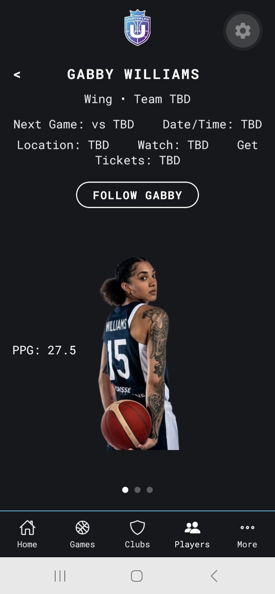
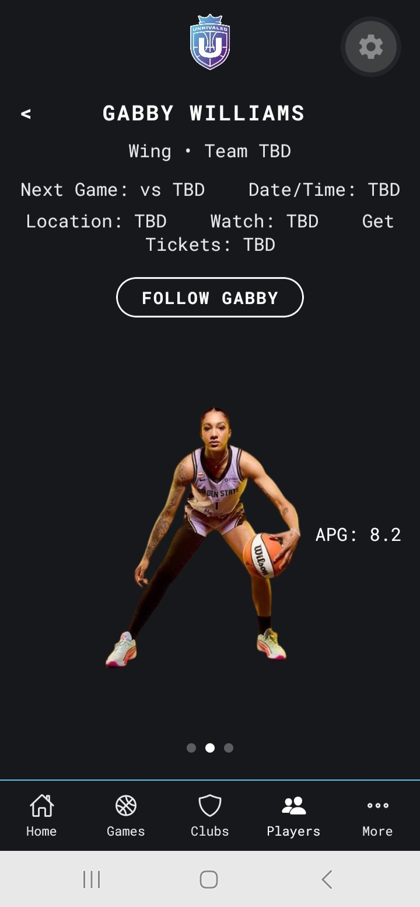
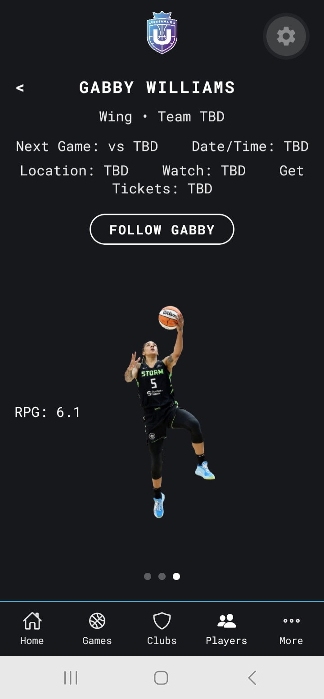
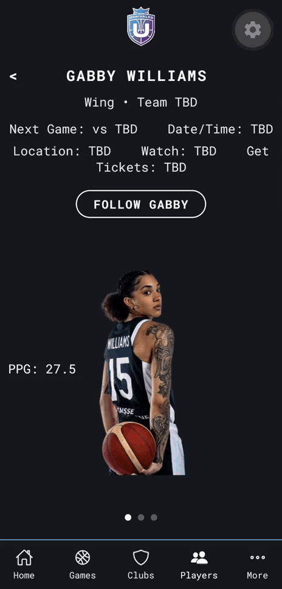

# Unrivaled Player Profile — Concept (Mobile)

A React Native + Expo concept screen for the Unrivaled Basketball app, built around a
single player's profile. The centerpiece is a scroll-driven image "stage" — three
player photos crossfade in place as the user swipes, each paired with a stat callout
that slides in from the side, with page-indicator dots and snap-to-image scrolling.

This project was built as a self-directed learning exercise and portfolio piece,
and is not affiliated with or endorsed by Unrivaled Basketball.

<p align="center">
  
  
  
</p>

<p align="center">
  
</p>

<p align="center"><em>Swiping the photo area: each image crossfades in place while its stat slides in from the side.</em></p>

## Features

- Fixed header with the Unrivaled logo, safe-area aware (clears notches/camera cutouts)
- Player name, team, and a "Follow" call-to-action button
- Next game info block (opponent, date/time, location, broadcast, tickets)
- Scroll-driven image gallery:
  - Three photos crossfade in the same fixed spot on screen
  - Associated stat (PPG / APG / RPG) slides in from the left or right as its photo comes to front
  - Scroll snaps cleanly to each image rather than free-scrolling
  - Page-indicator dots show which image is active
- Bottom tab navigation (Home, Games, Clubs, Players, More) with filled/outline icon states
- Accessibility: the back button has a screen-reader role and label ("Go back"), checked with Android TalkBack;
  remaining gaps are listed under Known Limitations
- Custom brand font (Roboto Mono, regular + a bold weight instanced from the variable font file)

## Tech Stack

- [React Native](https://reactnative.dev/) — mobile app framework
- [Expo](https://expo.dev/) (SDK 58) — build/run tooling and managed workflow
- [Expo Font](https://docs.expo.dev/versions/latest/sdk/font/) — loading custom typefaces
- [Expo Vector Icons](https://docs.expo.dev/guides/icons/) (Ionicons) — bottom nav icons
- [React Native Safe Area Context](https://github.com/th3rdwave/react-native-safe-area-context) — safe-area-aware layout
- React Native's built-in `Animated` API — all scroll-driven crossfade/slide animation, no animation library dependency
- [Claude](https://claude.com) (Anthropic), used through the Claude chat interface as an AI pair-programming assistant; see [AI-Assisted Development](#ai-assisted-development)

## AI-Assisted Development

I built this project with Claude through the chat interface, and no other AI tools, working one step at a time. Claude drafted and explained code; I ran it on a physical Android phone in Expo Go, reviewed the results, and made the design decisions.

Testing on the device caught problems that weren't visible in the code: photos ghosting through each other because the fade never reached zero opacity, a bottom nav bar sitting under the phone's system buttons, and the page-indicator dots hidden behind the nav bar after a layout change. For each one, I described what I saw on the phone, worked out the cause with Claude, and re-checked the fix on the device.

The `AGENTS.md` file and `.claude/` folder in this repo were generated by Expo's project template (`create-expo-app`); they aren't a record of how I used AI.

## Project Structure

```
.
├── App.js                      # Entry point; renders PlayerScreen inside SafeAreaProvider
├── src/
│   └── screens/
│       └── PlayerScreen.js     # The player profile screen (all current functionality)
├── assets/
│   ├── branding/                # Unrivaled logo
│   ├── player/                  # Player photos
│   └── fonts/                   # Roboto Mono variable font + extracted bold weight
└── package.json
```

## Running This Project

### Prerequisites

- [Node.js](https://nodejs.org/) installed on your machine (Expo SDK 58 requires 22.13 or newer
  on the 22 line, 24.3 or newer on the 24 line, or 26 and later)
- The [Expo Go](https://expo.dev/go) app installed on a physical iOS or Android phone
  (easiest way to preview), **or** Xcode (iOS Simulator) / Android Studio (Android Emulator)
  if you'd rather run it on a simulator

### Setup

1. Clone this repository:
   ```
   git clone https://github.com/SlimBloodworth/unrivaled_player_profile_concept_mobile.git
   cd unrivaled_player_profile_concept_mobile
   ```

2. Install dependencies:
   ```
   npm install
   ```

3. Start the Expo development server:
   ```
   npx expo start
   ```

4. Preview the app:
   - **On your phone (recommended):** open Expo Go and scan the QR code shown in the
     terminal (phone and computer must be on the same Wi-Fi network). This is the
     primary target platform and where the swipe/scroll interactions are tuned for.
   - **In a browser:** with the dev server running, press `w` in the terminal. This
     runs through React Native Web — most of the UI renders the same, but the image
     gallery's drag-to-scroll interaction was built and tested for a touchscreen, so
     a mouse-drag may feel slightly different than it does on a phone.

> **Expo Go version note:** Expo Go from the app stores only supports the newest Expo SDK,
> and this project uses SDK 58. If Expo Go shows a "Project is incompatible with this version
> of Expo Go" error (for example, after a newer SDK is released), either install the matching
> Expo Go version for an Android device or simulator from [expo.dev/go](https://expo.dev/go),
> or upgrade the project by following
> [Expo's upgrade guide](https://docs.expo.dev/workflow/upgrading-expo-sdk-walkthrough/).

## Known Limitations / Next Steps

- Bottom nav items (Home, Games, Clubs, etc.) currently only highlight on tap, and the
  back and Follow buttons don't do anything yet — real navigation and actions aren't wired up
- Accessibility is partial: only the back button has an explicit screen-reader role and label.
  The photo gallery's images are unlabeled, and the bottom nav doesn't announce which tab is selected
- Player stats, team, and next-game details are placeholder data pending a real data source
- The brand gradient/glow effects explored during development were simplified in favor
  of a flat background, since React Native has no built-in radial gradient or blur;
  a true version of either would need an additional library (`react-native-svg` or `expo-blur`)

## License

See [`LICENSE`](./LICENSE) for details.